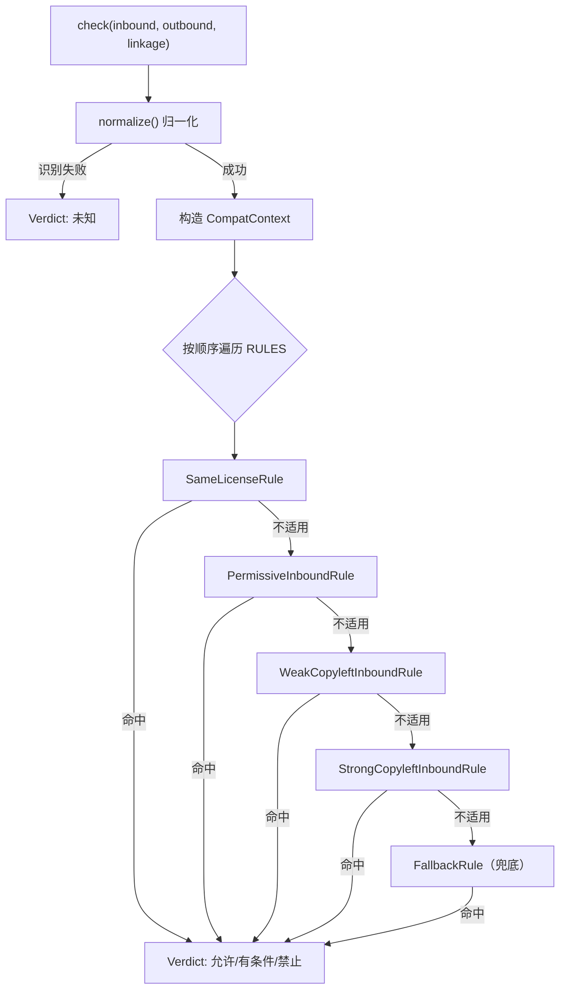

# 设计说明（对应考核项：开源方案与设计汇报 20%）

> 本文是「问题 / 模式 / 架构接口复用」这条观测点的书面材料，可直接作为汇报提纲。

---

## 一、问题定义（Problem）

**一句话**：开发者知道要给项目选个许可证，却不知道**引用的依赖会不会让自己的选择变成违规**。

问题被拆成三个可回答的子问题：

| 子问题 | 输入 | 输出 |
|--------|------|------|
| Q1 我能不能这样发布？ | 依赖的许可 + 我的许可 + 链接方式 | 允许 / 有条件 / 禁止 + 依据 |
| Q2 我要履行什么义务？ | 我的许可（及各依赖许可） | 可勾选的义务清单 |
| Q3 这份依赖清单整体是否合规？ | 清单文件 + 我的许可 | 合规报告 + 冲突定位 |

**为什么值得做**

- 真实痛点：许可违规的发现成本极高（发布后、商用前），而预防成本极低。
- 结论可验证：判定规则来自许可条文之间的包含关系，可逐条追溯依据。
- 受众明确：同班同学、校内小组项目、个人开源项目都能直接使用。

---

## 二、已有方案与差异化（Differentiation）

| 已有工具 | 它做了什么 | 它不做什么（= 我们的切入点） |
|----------|------------|------------------------------|
| `pip-licenses` | 列出已安装依赖的许可证 | 不做兼容性判定，不告诉你"能不能用 MIT 发布" |
| `licensecheck` | 从文件/依赖里识别许可证 | 只输出识别结果，无义务清单、无冲突结论 |
| `FOSSA` / `Snyk` | 完整合规平台 | 重、需联网/商用授权，学习与个人项目用不上 |
| `git diff` | 比较代码差异 | 与许可合规完全无关 |

**差异化总结（一句话）**：
> 别人告诉你"你用了什么许可"，我们告诉你"**你还能不能这样发布**，以及**你必须做什么**"。

并且把课堂上的「常用许可证对比」这张**静态表格**变成了**可执行、可扩展、可测试的规则**。

---

## 三、设计模式与架构（Pattern & Architecture）

### 3.1 分层

```
┌──────────────────────────────────────────────┐
│  cli.py          界面层：argparse + 输出渲染   │  只负责"怎么说"
├──────────────────────────────────────────────┤
│  core.py         逻辑层：                       │  只负责"怎么判"
│    normalize()   归一化                         │
│    RULES[]       兼容性规则引擎（策略模式）      │
│    scan_text()   依赖清单解析                    │
│    render_*()    报告渲染                        │
├──────────────────────────────────────────────┤
│  licenses.py     数据层：许可知识库              │  只负责"是什么"
└──────────────────────────────────────────────┘
```

**依赖方向单向向下**：界面层依赖逻辑层，逻辑层依赖数据层，反向无依赖。
好处：把 `cli.py` 整个删掉，`core.py` 依然可被测试、被别的程序调用（例如将来做 Web 服务或 CI 插件）。

### 3.2 核心模式：策略模式 + 规则注册表



```python
class CompatibilityRule(Protocol):
    name: str
    def match(self, ctx: CompatContext) -> Verdict | None: ...

RULES = (SameLicenseRule(), PermissiveInboundRule(),
         WeakCopyleftInboundRule(), StrongCopyleftInboundRule(), FallbackRule())
```

**为什么这么抽象**（汇报时重点讲这段）：

1. **开闭原则**：新增一条规则 = 新增一个类并注册，`check()` 一行不用改。
2. **顺序即优先级**：规则列表天然表达了"例外优先于通则"（例如 Apache-2.0 → GPL 这条特例由 `PermissiveInboundRule` 内的条件分支处理，永远先于兜底）。
3. **可测试**：每条规则都能单独构造 `CompatContext` 断言输出，不需要跑 CLI。
4. **诚实兜底**：`FallbackRule` 保证任何组合都有结论，且结论是「有条件 + 请人工确认」——**绝不假装知道**。这是本项目最重要的设计取舍。

### 3.3 数据与逻辑分离

`LicenseInfo` 是纯数据（`frozen=True` 的 dataclass），包含 `obligations`（义务）、`category`（类型）、`aliases`（别名）。
判定逻辑**不硬编码任何许可名**（除了 Apache-2.0 的专利特例，属于领域知识），而是通过 `is_permissive` / `is_weak_copyleft` / `is_strong_copyleft` 这类**语义属性**做判断。

好处：新增一种宽松许可（如 ISC），**零行逻辑代码**即可被规则引擎正确处理——这已经在 `OPTIONAL_LICENSES` 中被验证（测试 `test_list_all_includes_optional_extension`）。

### 3.4 接口契约

| 接口 | 契约 |
|------|------|
| `normalize(raw) -> str \| None` | 识别失败返回 `None`，**不抛异常、不猜** |
| `check(...) -> Verdict` | 任何输入都返回 `Verdict`，`level` ∈ {允许, 有条件, 禁止, 未知} |
| `Verdict.exit_code` | 允许=0 / 有条件=1 / 禁止=2 / 未知=3，供 CI 使用 |
| 依赖清单格式 | 每行 `<包名> [比较符+版本] [# 许可证]`，`#` 开头为注释 |
| `Renderers` | 输入 `Report`，输出 `str`（当前 Markdown，可扩展 HTML/JSON） |

---

## 四、扩展点（Extensibility）

| 需求 | 改动位置 | 是否需要动核心逻辑 |
|------|----------|--------------------|
| 新增一种许可证 | `licenses.py` 加一条 `LicenseInfo` | 否 |
| 新增一条判定规则（如 AGPL 网络服务条款） | `core.py` 加一个类 + 注册进 `RULES` | `RULES` 元组加一项 |
| 新增输出格式（HTML / JSON） | 加一个渲染函数 | 否 |
| 新增输入格式（`requirements.txt` / `package.json`） | 加一个解析函数，返回 `Finding` 列表 | 否 |
| 自动抓取依赖许可（PyPI / npm） | 加一个数据源类，替换 `license_raw` 来源 | 否 |

**新人上手路径**（对应互评「扩展是否容易下手」）：
读 `licenses.py`（10 分钟）→ 读 `core.py` 的 `RULES` 与 4 个规则类（20 分钟）→ 跑 `tests/`（1 分钟）→ 照着 `CONTRIBUTING.md` 第 5 节加一条规则。

---

## 五、设计取舍（Trade-off）

| 取舍 | 选择 | 理由 |
|------|------|------|
| 判定不确定时 | 输出「有条件 + 人工确认」 | 合规问题**假阳性比假阴性危险**：错误的"通过"会导致真实违规 |
| 是否内置法律免责声明 | 报告末尾固定输出 | 明确工具边界，避免被当成法律意见 |
| 依赖清单是否自动解析许可证 | V1 不自动，要求手工标注 | 自动抓取需联网与第三方元数据，会引入不可控误差；先把规则引擎做扎实 |
| 是否需要第三方依赖 | 零依赖 | 保证"按文档能跑通"（互评可用性 30%），也方便老师在无网环境验收 |
| 项目许可证 | MIT | 无传染、义务最少，便于被同学复用与嵌入（呼应课堂建议"工具/作业首选之一"） |

---

## 六、测试策略

- 全部使用标准库 `unittest`，**38 个用例**，零第三方依赖。
- 覆盖四类：归一化（含别名与非法输入）、义务清单、兼容性规则（含 LGPL 动/静态对比）、清单扫描与报告渲染。
- CLI 层用 `contextlib.redirect_stdout` 直接调用 `main(argv)` 断言**退出码与输出**，不依赖子进程。
- CI（GitHub Actions）在 Python 3.10 / 3.11 / 3.12 上跑全量测试。

---

## 七、后续演进

1. **V0.2**：自动解析 `requirements.txt` / `package.json` / `pom.xml`，从包元数据抓取许可（带本地缓存）。
2. **V0.3**：HTML 报告 + 兼容性矩阵图；`--fail-on` 策略让 CI 直接卡住不合规的 PR。
3. **V0.4**：支持 SPDX 表达式（`MIT OR Apache-2.0`）与双许可选择建议（"选哪一条对你更有利"）。
4. **长期**：把规则库外部化成数据文件（JSON/YAML），让非程序员也能贡献规则。
